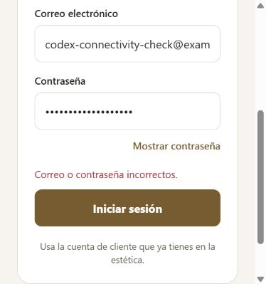

# Conexión de acceso con el backend existente

La app se configuró con la misma API utilizada por la web publicada:
https://esteticaa-backend-five.vercel.app/api

Este es el backend publicado de la estética (production); no es un servidor aislado de pruebas. No se crearon cuentas ni se modificaron registros para comprobar la conexión.

## Cambios

- `.env`: configuración local con EXPO_PUBLIC_API_URL. Git lo ignora; no contiene contraseñas ni tokens.
- `.env.example`: plantilla con la URL pública verificada, para que otra instalación pueda configurarse.
- `package.json`: los comandos de Expo usan el puerto 5173. El backend ya permite http://localhost:5173 para navegador, así que no se modificó su configuración de permisos.
- `scripts/probar-acceso.cmd`: abre el proyecto correcto, prepara .env si falta, explica cómo probar y ejecuta npm start. No pide ni registra credenciales.
- `README.md`: explica la conexión y la prueba en navegador o teléfono.

No se añadió un backend dentro de AppMovil. La app consume POST /api/auth/login del servidor existente.

## Comprobaciones realizadas

| Comprobación | Resultado |
| --- | --- |
| GET / del backend | HTTP 200, Online |
| OPTIONS /api/auth/login con Origin http://localhost:5173 | HTTP 204, permite ese origen |
| POST /api/auth/login con cuenta ficticia inexistente | HTTP 400, Usuario no encontrado; no se concedió sesión |
| Formulario web conectado | Muestra Correo o contraseña incorrectos ante la respuesta real; se mantiene en acceso |
| Pruebas unitarias | 16 aprobadas |
| TypeScript y lint | Aprobados |

La prueba con una cuenta inexistente verifica que el endpoint de acceso está disponible y responde desde el servidor real. No demuestra un inicio de sesión exitoso ni sustituye las comprobaciones con una cuenta de cliente válida.

## Probar personalmente

1. En PowerShell ejecutar `.\scripts\probar-acceso.cmd`.
2. Esperar a que Expo esté listo y pulsar `w`, o abrir http://localhost:5173/sign-in.
3. Introducir una cuenta existente de CLIENTE; la cuenta administrativa permanece en la web.
4. Comprobar que aparece el menú del cliente, cerrar sesión, iniciar otra vez y recargar o reabrir la app.
5. En teléfono usar Expo Go compatible con SDK 57 y el QR de la terminal. La API pública es accesible desde el teléfono; el equipo y el teléfono deben poder comunicarse para cargar el proyecto de Expo.

En web la sesión se guarda solo durante la sesión de la pestaña. En Android/iOS se usa SecureStore. La comprobación completa del guardado en teléfono (#31) y el acceso válido (#13) sigue pendiente hasta realizar estos pasos con una cuenta real.

Si otro programa ocupa el puerto 5173, detener ese programa antes de esta prueba. Usar otro puerto de navegador requiere que el backend permita su origen; la app nativa no usa ese permiso de navegador.

Captura de la comprobacion con datos ficticios:

